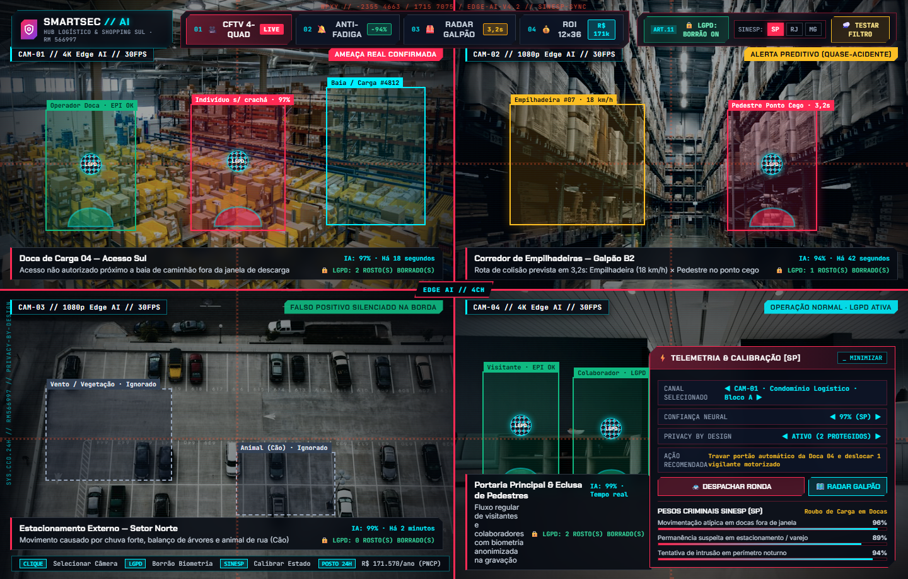
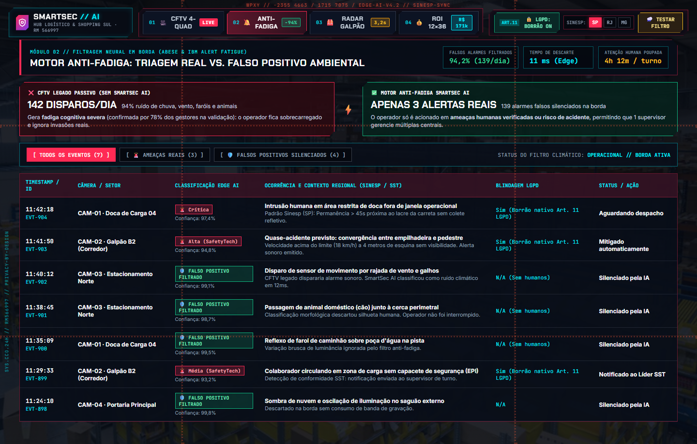
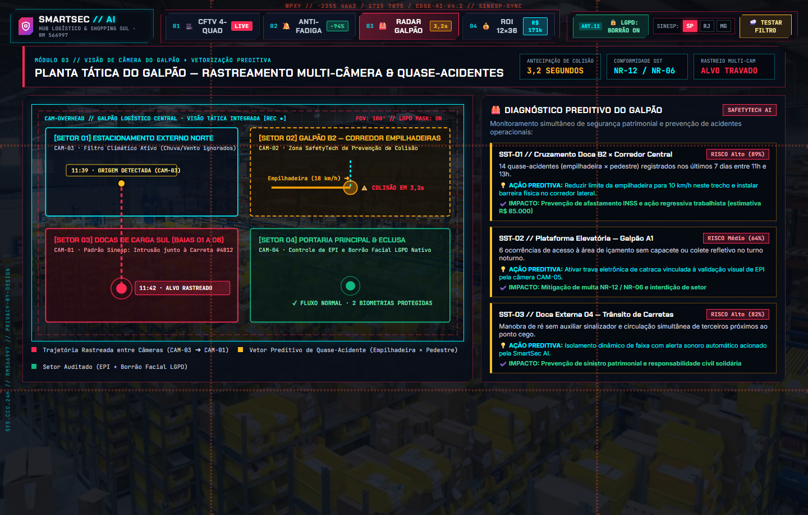
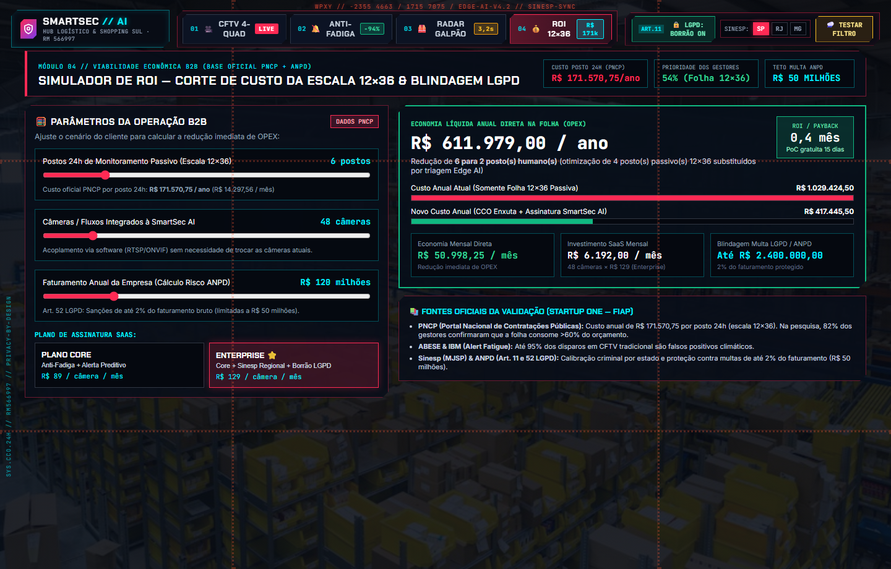
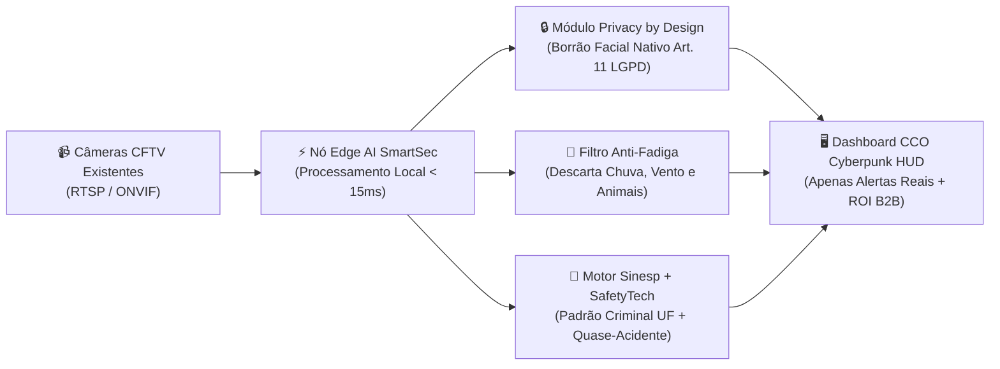

<div align="center">

# 🛡️ SmartSec AI // Cyber-Optics CFTV Preditivo

**Sistema Inteligente de Monitoramento Preditivo, Anti-Fadiga de Alarmes e Blindagem LGPD na Borda (Edge AI)**

[-ED145B?style=for-the-badge)](https://www.fiap.com.br)
[](https://smartsec-ai.vercel.app)
[]()
[]()

<p align="center">
  <a href="https://smartsec-ai.vercel.app"><strong>🚀 Acessar Protótipo Navegável (Vercel)</strong></a> •
  <a href="./Atividade_Prototipacao_Startup_One_RM566997.pdf"><strong>📄 Documentação Oficial Startup One (PDF)</strong></a> •
  <a href="https://renan-xavier.vercel.app/projetos/smartsec-ai"><strong>💼 Ver no Portfólio</strong></a>
</p>

</div>

---

## 🎓 Destaque Acadêmico — Startup One (FIAP · 2TDS)

> **Curso:** Tecnologia em Análise e Desenvolvimento de Sistemas (FIAP) — Fase 04  
> **Autor / Empreendedor:** Renan Santa Rosa Xavier (RM 566997)  
> **Tema de Pesquisa:** *As Dores dos Sistemas de Monitoramento por Sistemas de Segurança Dinâmica, e a Possibilidade do Desenvolvimento para Sistemas Inteligentes Através da Inteligência Artificial e seu Impacto Econômico no Meio.*

A **SmartSec AI** é uma startup **B2B SaaS / AIaaS** concebida e validada ao longo das etapas do **Startup One (FIAP)**. A plataforma acopla uma camada de **Visão Computacional em Borda (Edge AI)** diretamente às câmeras e centrais de monitoramento (CCOs) já existentes em **Shopping Centers, Condomínios Logísticos e Indústrias**, sem exigir troca de hardware.

---

## 🎯 Os 4 Problemas Reais que a SmartSec AI Resolve (Validação de Mercado)

Com base em dados públicos oficiais e pesquisa de validação com **50 tomadores de decisão B2B** (Diretores de Operações, Gestores de Segurança Patrimonial e Síndicos Profissionais), o projeto ataca quatro dores críticas:

| Pilar | Problema no CFTV Tradicional | Dados Oficiais & Validação | Solução SmartSec AI |
| :--- | :--- | :--- | :--- |
| **1. Dor Financeira (Escala 12×36)** | Manter vigilantes 24h olhando passivamente para dezenas de telas consome mais de 60% do orçamento. | **R$ 171.570,75/ano** por posto 24h segundo planilha oficial do **PNCP** (eleito prioridade #1 por **54%** dos gestores). | Triagem autônoma por IA que permite que **1 supervisor gerencie o equivalente a múltiplos postos passivos**. |
| **2. Dor Operacional (Fadiga de Alarmes)** | Chuva, vento, faróis e animais geram até 95% de disparos falsos, cegando o operador pelo cansaço cognitivo. | Estudos **ABESE / IBM (*Alert Fatigue*)** e nota crítica 4–5 dada por **78%** dos gestores entrevistados. | **Motor Anti-Fadiga em Borda** que descarta ruídos climáticos e animais em `< 15ms` antes de tocar o alarme. |
| **3. Dor Regional & SST (*SafetyTech*)** | Softwares importados são genéricos e ignoram a dinâmica criminal de cada estado brasileiro e riscos trabalhistas. | **Sinesp / MJSP** comprova padrões criminais distintos por UF (**74%** dos gestores criticaram sistemas genéricos). | **Calibração Regional Sinesp (SP, RJ, MG)** + predição de **quase-acidentes** (empilhadeira × pedestre com `3,2s` de antecedência). |
| **4. Dor Jurídica (Passivo LGPD)** | Gravar rostos identificáveis sem proteção expõe empresas a sanções milionárias por tratamento irregular de biometria. | **Art. 11 e Art. 52 da LGPD (ANPD)**: multas de até **2% do faturamento** (limitadas a **R$ 50 milhões**). | **Módulo *Privacy by Design***: anonimização e borrão facial nativo na borda em tempo real. |

---

## 🖥️ Telas do Protótipo Navegável (Interface Cyberpunk HUD)

> 🔗 **Teste ao vivo no navegador:** [**https://smartsec-ai.vercel.app**](https://smartsec-ai.vercel.app)

### 1. Central CFTV 4-Quad em Tela Cheia + Menus Flutuantes + Borrão Facial LGPD
As 4 câmeras cobrem 100% da tela em divisão 2×2 com retícula óptica estilo Cyberpunk, caixas delimitadoras de Visão Computacional, silhuetas com **mosaico de borrão facial nativo (`LGPD`)** e controles flutuantes no topo e na lateral direita.



---

### 2. Motor Anti-Fadiga de Alarmes (Triagem Real vs. Falso Positivo Ambiental)
Comparativo em tempo real entre o CFTV passivo legado (`142 disparos/dia` com 94% de falso positivo) e o motor neural da SmartSec AI (`apenas 3 alertas reais` após filtrar 139 ruídos climáticos de chuva, vento e animais na borda).



---

### 3. Planta Tática Preditiva do Galpão (*SafetyTech* & Rastreamento Multi-Câmera)
Visão tática sobreposta à câmera do galpão logístico, exibindo o rastreamento automático da trajetória do suspeito entre câmeras (`CAM-03 ➔ CAM-01`) e o vetor preditivo de colisão entre empilhadeira e pedestre (`3,2s antes do impacto`).



---

### 4. Simulador Comercial B2B de ROI (Escala 12×36 PNCP & Blindagem ANPD)
Calculadora interativa para reuniões comerciais B2B fundamentada no custo oficial do **PNCP (`R$ 171.570,75/ano` por posto 24h)**. Permite simular a redução imediata da folha de monitoramento passivo (`R$ 611.979,00/ano` em uma operação de 6 postos, com *payback* de `0,4 mês`) e o teto de multa evitada da ANPD.



---

## 🏗️ Arquitetura da Solução (Edge AI + SaaS B2B)



---

## 🛠️ Tecnologias e Estrutura do Repositório

- **Front-end Interativo:** HTML5 Semântico, CSS3 Avançado (Cyberpunk HUD, `clip-path`, CSS Grid 2×2 Fullscreen, animações ópticas), JavaScript Vanilla (`ES6+`) em português claro.
- **Automação Documental:** Python (`python-docx`) para geração automatizada dos entregáveis acadêmicos no padrão FIAP.
- **Deploy:** Vercel Production (`https://smartsec-ai.vercel.app`).

```text
SmartSec AI/
├── prototipo/
│   ├── index.html          # Interface Cyberpunk HUD (4 módulos interativos)
│   ├── estilo.css          # Estilização 2x2 Fullscreen, menus flutuantes e retícula óptica
│   ├── dados.js            # Base de dados Sinesp (SP/RJ/MG), câmeras, fila de eventos e PNCP
│   ├── app.js              # Lógica de troca de abas, toggle LGPD, filtro anti-fadiga e cálculo de ROI
│   └── img/                # Cenas reais de câmeras (doca, galpão, estacionamento e portaria)
├── entrega/
│   ├── prints/             # Capturas de tela 1440x920 das 4 abas do protótipo
│   ├── gerar_entrega.py    # Script gerador do DOCX e PDF no template oficial FIAP
│   └── 2TDS_Fase04_Cap08_Atividade_Prototipacao_Startup_One_RM566997.pdf
└── Atividade_Prototipacao_Startup_One_RM566997.pdf
```

---

<div align="center">
  Desenvolvido por <strong>Renan Santa Rosa Xavier (RM 566997)</strong> — Análise e Desenvolvimento de Sistemas @ <strong>FIAP</strong>
</div>
